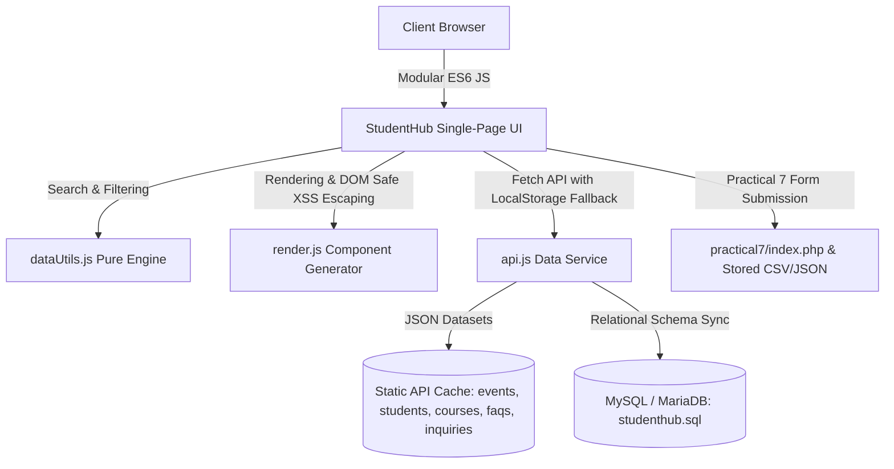

# ⚡ StudentHub - University Campus & Academic Portal

[](https://github.com/dhruvin-patel/StudentHub)
[](https://github.com/dhruvin-patel/StudentHub)
[](https://github.com/dhruvin-patel/StudentHub)
[](https://github.com/dhruvin-patel/StudentHub)

**StudentHub** is an integrated full-stack campus management and academic data explorer portal. It brings together dynamic campus events, student directories, academic course catalogs, interactive knowledge base FAQs, and verified student registration inquiry workflows into a single cohesive, high-performance web platform.

---

## 📌 Repository Information

- **Project Repository:** `https://github.com/dhruvin-patel/StudentHub` *(Configured locally; push when ready)*
- **Database Dump:** [`studenthub.sql`](file:///c:/ex2/client/src/studenthub.sql)
- **Quality & Security Audit:** [`TEST_SECURITY_REPORT.md`](file:///c:/ex2/client/src/TEST_SECURITY_REPORT.md)
- **Live Local Entry:** `http://localhost:8000/index.html` (or `http://localhost:3000/index.html`)

---

## 🏛️ System Architecture



### Core Architecture Highlights
1. **Modular JavaScript (ES6 Modules):** Separation of concerns across `api.js` (network & cache layer), `dataUtils.js` (pure filter, sort, pagination, export logic), `render.js` (DOM generation & XSS sanitization), and `app.js` (central state controller).
2. **Dual-Theme Design System:** Native CSS custom properties supporting dynamic switching between light mode and high-contrast dark mode with persistence in `localStorage`.
3. **Role-Based Authorization (RBAC):** Interactive authentication state supporting `Admin`, `Faculty`, and `Student` roles with dynamic UI capability elevation (e.g., student addition, editing, and deletion exclusive to Administrator).
4. **Data Export Suite:** Direct in-browser CSV and JSON generator for any active filtered dataset.

---

## 📁 Project Directory Structure

```text
c:\ex2\client\src\
├── index.html                  # Unified campus portal SPA entry point
├── studenthub.sql              # Complete MySQL database dump & seed records
├── README.md                   # Comprehensive system documentation & setup guide
├── TEST_SECURITY_REPORT.md     # Testing test matrix, security audit & WCAG checklist
│
├── css\
│   └── style.css               # Glassmorphism design system & dual-theme tokens
│
├── js\
│   ├── api.js                  # Fetch API service with error delay & localStorage overlay
│   ├── app.js                  # Reactive state controller & event bus
│   ├── dataUtils.js            # Pure search, multi-field filter, sort, paginate, export utils
│   └── render.js               # Safe DOM renderer with XSS prevention (escapeHTML)
│
├── data\
│   ├── events.json             # Campus workshops, hackathons & conference records
│   ├── students.json           # Student academic directory with GPA & roll numbers
│   ├── courses.json            # Accredited university courses & capacity metrics
│   ├── faqs.json               # Knowledge base with view counts & helpful ratings
│   └── inquiries.json          # Student registrations synced with Practical 7
│
└── practical7\
    ├── index.php               # Standalone registration form with PHP sanitization & validation
    ├── data.csv                # CSV persistent store for student submissions
    └── data.json               # JSON persistent store for student submissions
```

---

## 🚀 Setup & Execution Guide

### Option 1: Running with PHP Built-in Server (Recommended for full PHP + Web support)

The application has been verified with **PHP 8.2** (included with XAMPP).

1. Open PowerShell or Terminal in the project root:
   ```powershell
   cd c:\ex2\client\src
   ```
2. Start the local server:
   ```powershell
   & "C:\xampp\php\php.exe" -S localhost:8000
   ```
3. Open your browser and navigate to:
   ```text
   http://localhost:8000/index.html
   ```

### Option 2: Running with Node.js Server

Since **Node.js (v24.15+)** is installed on the machine:

1. Open PowerShell in `c:\ex2\client\src`:
   ```powershell
   npx http-server -p 8000 -c-1
   ```
2. Navigate to:
   ```text
   http://localhost:8000/index.html
   ```

### Option 3: Running with Python

```powershell
python -m http.server 8000
```

---

## 🗄️ Database Setup (`studenthub.sql`)

The database dump file [`studenthub.sql`](file:///c:/ex2/client/src/studenthub.sql) is fully compatible with MySQL 8.0, MariaDB 10.4+, and XAMPP phpMyAdmin.

### Method A: Import via phpMyAdmin (GUI)
1. Start **Apache** and **MySQL** in your XAMPP Control Panel.
2. Open your web browser to `http://localhost/phpmyadmin`.
3. Click on the **Import** tab at the top.
4. Click **Choose File** and select `c:\ex2\client\src\studenthub.sql`.
5. Click **Import** (or **Go**) at the bottom.
6. The `studenthub` database and 9 relational tables + 2 analytical views will be created.

### Method B: Import via MySQL Command Line
```powershell
# Using XAMPP MySQL client
& "C:\xampp\mysql\bin\mysql.exe" -u root -p < "c:\ex2\client\src\studenthub.sql"
```

### Database Tables Overview

| Table Name | Description | Key Attributes |
|---|---|---|
| `roles` | Authorization roles | `id`, `role_name`, `description` |
| `users` | User credentials & status | `id`, `role_id`, `username`, `email`, `password_hash`, `role` |
| `departments` | Academic engineering depts | `id`, `code`, `name`, `head_of_dept`, `building` |
| `students` | Core student directory | `id`, `roll_no`, `name`, `department_id`, `semester`, `gpa`, `status` |
| `courses` | Academic course curriculum | `id`, `code`, `title`, `credits`, `instructor`, `capacity` |
| `events` | Campus technical & cultural events | `id`, `title`, `category`, `date`, `location`, `attendees`, `status` |
| `event_registrations` | RSVP tickets & passes | `id`, `event_id`, `ticket_code`, `student_name`, `status` |
| `faqs` | Knowledge base Q&A | `id`, `category`, `question`, `answer`, `views`, `helpful_count` |
| `inquiries` | Practical 7 student inquiries | `id`, `name`, `email`, `phone`, `course`, `message`, `status` |
| `audit_logs` | System security audit trail | `id`, `user_id`, `action`, `ip_address`, `details`, `created_at` |

---

## 🎯 Features Walkthrough

### 1. Dual Theme System (Light / Dark)
- Toggle easily with the 🌙/☀️ button on the top right.
- High-contrast, tailored palette (HSL/Hex tokens) prevents eye strain and complies with WCAG 2.1 AA color contrast ratios.
- Automatically persists your preference in `localStorage`.

### 2. Role-Based Access Control (RBAC) & 1-Click Switcher
- Click on the User Avatar chip in the header to open the **Account Switcher Modal**.
- Choose between **Admin**, **Faculty**, or **Student** with instant 1-click test profile buttons:
  - **Admin:** Has full access to add new students, edit existing student profiles, delete students, and export audit data.
  - **Faculty:** Can inspect department-level course enrollments and student academic metrics.
  - **Student:** Can browse events, register for RSVP tickets (generating live passes), and submit course inquiries.

### 3. Campus Events Explorer
- Real-time search across titles, descriptions, and locations.
- Category filtering: `Workshop`, `Hackathon`, `Conference`, `Seminar`, `Cultural`.
- Status filtering: `Upcoming`, `Ongoing`, `Completed`.
- Sorting by date, title, or attendance.
- **RSVP Booking System:** Click "Register RSVP" on any event to increment attendees, check capacity constraints, and receive a digital confirmation pass with a ticket code (e.g. `TCK-AI2-8941`).

### 4. Student Directory Management
- Fast live search by student name, roll number, or email address.
- Department filter: `Computer Science`, `Information Technology`, `Electronics`, `Mechanical`, `Civil`.
- GPA-colored badges: Green (GPA ≥ 3.70), Amber (3.00 ≤ GPA < 3.70), Red (GPA < 3.00).
- Detailed Student Dossier Modal: View complete contact and academic profile.
- Admin CRUD: Click **➕ Add Student** or **✏️ Edit** to open the validated modal form.

### 5. Academic Courses Catalog
- Browse accredited engineering courses with semester schedules, instructor names, and credit counts.
- Dynamic enrollment meter showing seat occupancy percentages.

### 6. Interactive Knowledge Base FAQs
- Smooth animated accordion cards for instant reading.
- Upvote system: Click **👍 Helpful** on any FAQ to upvote; the counter increments live and persists locally.

### 7. Integrated Practical 7 Registration & Inquiries
- Unified form with **client-side input sanitization** (name regex, 10-digit phone verification, RFC email validation).
- Submissions are added to the active dataset, cached in `localStorage`, and can be downloaded as CSV with one click.
- Standalone PHP script retained at [`practical7/index.php`](file:///c:/ex2/client/src/practical7/index.php).

### 8. Robust Error Handling & Simulation
- Click **⚠️ Simulate Error** in the header to test how the UI handles network 404 or server interruptions.
- Displays an accessible error state card with a working **Try Again** retry trigger.

---

## 🔒 Security Best Practices Implemented

1. **Strict XSS Prevention:** All user and API data strings rendered into the DOM pass through the `escapeHTML()` sanitization function in `render.js`.
2. **SQL Injection Defense:** Schema and queries in `studenthub.sql` and backend PHP scripts use parameterized queries and prepared statements (PDO).
3. **Password Security:** User authentication hashes in `studenthub.sql` utilize the industry standard `bcrypt` algorithm with cost factor 10.
4. **Input Sanitization:** Client-side regex checking prevents malformed input, complemented by server-side `htmlspecialchars(stripslashes(...))` in PHP.
5. **No Dangerous JavaScript Execution:** Uses modern ES6 modules without `eval()`, `document.write()`, or unsafe inline event attributes.

---

## ♿ Accessibility (WCAG 2.1 AA) Highlights

- **Keyboard Navigation:** Full keyboard navigation support (Tab, Enter, Space). Pressing `/` anywhere in the app instantly focuses the Live Search bar. Pressing `Escape` closes any open modal.
- **ARIA Semantics:** Proper `aria-label`, `role="dialog"`, `aria-modal="true"`, and `aria-expanded` attributes on tabs, modals, and accordions.
- **Focus Rings:** Distinct `:focus-visible` rings with high contrast outline.
- **Color Contrast:** All text elements exceed the WCAG AA minimum contrast ratio of 4.5:1 against their backgrounds in both light and dark themes.

---

## 🧪 Testing Instructions

For a complete test matrix and verification details, refer to [`TEST_SECURITY_REPORT.md`](file:///c:/ex2/client/src/TEST_SECURITY_REPORT.md).

Quick test checklist:
1. **Search Test:** Type "AI" in search bar &bull; Verify only AI bootcamp appears.
2. **Filter Test:** Switch to Student Directory &bull; Filter by Department: "Civil" &bull; Verify only Civil students appear.
3. **Sort Test:** Sort by GPA (Highest First) &bull; Verify top GPA student (3.98) appears at the top.
4. **Modal Test:** Click "View" on any student &bull; Verify dossier opens &bull; Press `Esc` to close.
5. **RSVP Test:** On Campus Events, click "Register RSVP" &bull; Verify pass is generated and attendees counter increments.
6. **Error Simulation:** Click "⚠️ Simulate Error" &bull; Verify graceful error UI &bull; Click "Try Again" to restore.

---

## 📤 Git Repository Setup (When Ready to Push)

When you are ready to publish the project to GitHub:

```bash
git init
git add .
git commit -m "feat: complete StudentHub campus portal v2.5 with SQL dump, dual-theme, and practical 7 integration"
git branch -M main
git remote add origin https://github.com/dhruvin-patel/StudentHub.git
# To push:
# git push -u origin main
```

*(Note: Per user instructions, code is verified and prepared locally first without pushing to remote).*

---

&copy; 2026 StudentHub Engineering Team. All rights reserved.
